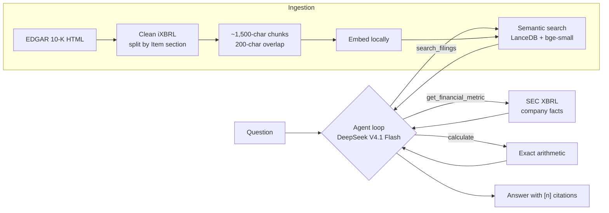

# edgar-rag-analyst

An AI analyst that answers questions about SEC 10-K filings for 16 companies (Apple, Microsoft and 14 semiconductor makers, from NVIDIA to Intel), with a citation for every claim. **Explanations come from the filing text (RAG); numbers come from the SEC's structured XBRL data through function calls, and arithmetic is done by a calculator tool.** A 58-question eval suite measures the result.

Everything runs locally except the LLM call: free SEC data, a local embedding model and an embedded vector database.

```
$ edgar ask "Compare Apple, Microsoft and NVIDIA's gross margins in their latest fiscal years,
             and what does NVIDIA say about its customer concentration?"

Tool calls:
  step 1: get_financial_metric(ticker='AAPL', metric='gross_profit', fiscal_year=2025)
          -> [1] Apple Inc. gross_profit FY2025 (2024-09-29 to 2025-09-27): 195,201,000,000.00 USD
  ...     (revenue and gross profit for all three companies, plus one filing search)
  step 2: calculate(operation='ratio', a=153463000000, b=215938000000)
          -> ratio(a=153,463,000,000.00, b=215,938,000,000.00) = 0.7107

| Company   | FY     | Gross Profit | Revenue     | Gross Margin |
|-----------|--------|--------------|-------------|--------------|
| Apple     | FY2025 | $195.2B [1]  | $416.2B [2] | 46.9%        |
| Microsoft | FY2026 | $225.5B [3]  | $331.8B [4] | 67.9%        |
| NVIDIA    | FY2026 | $153.5B [5]  | $215.9B [6] | 71.1%        |

NVIDIA states that "our revenue is concentrated among a limited number of direct and
indirect customers" [7]. In FY2026, one direct customer was 22% of total revenue and
another 14%, both primarily in the Compute & Networking segment [7]. ...

Sources:
 *[1] SEC XBRL GrossProfit, AAPL FY2025 (10-K filed 2025-10-31)
 ...
 *[7] NVIDIA CORP 10-K (2026-01-25), Item 7. Management's Discussion and Analysis ...

3 LLM calls · 8463 prompt + 1205 completion tokens
```

## How it works



1. **Ingest** ([sec_client.py](src/edgar_rag/sec_client.py), [chunking.py](src/edgar_rag/chunking.py), [index.py](src/edgar_rag/index.py)): download each company's latest 10-K, strip the hidden XBRL metadata, split it into Item sections (Risk Factors, MD&A, …), pack paragraphs into ~1,500-character chunks with overlap, embed them locally with `bge-small-en-v1.5`, and store them in LanceDB with company, section and source metadata.
2. **Answer** ([agent.py](src/edgar_rag/agent.py), [tools.py](src/edgar_rag/tools.py)): the LLM gets three tools defined by Pydantic models. It searches filing text for explanations, looks up exact figures in XBRL data, and calls a calculator for growth rates and margins. The loop runs until it answers (6 LLM calls at most), and every source gets a citation number.
3. **Evaluate** ([scoring.py](src/edgar_rag/scoring.py), [evaluation.py](src/edgar_rag/evaluation.py)): a hand-labelled question set scored on numbers, retrieval, key facts (LLM judge) and refusals, comparing the agent with plain RAG.

## Eval results

58 questions across 16 companies, including 7 sector questions that span all 13 semiconductor companies. Expected numbers come from XBRL; narrative answers are checked against key facts verified in the filing text, graded by `deepseek-v4-pro` (a different, stronger model than the one answering). **Simple** is plain RAG: one search, then one LLM call, with no tools.

| Metric | agent | simple |
|---|---|---|
| **Overall pass rate** | **100%** | 60% |
| Numeric (12) | 100% | 83% |
| Narrative (18) | 100% | 78% |
| Mixed: numbers + explanation (4) | 100% | 50% |
| Comparison across companies (5) | 100% | 0% |
| Trend across years (4) | 100% | 0% |
| Sector: rankings across 13 companies (7) | 100% | 14% |
| Unanswerable, refused correctly (8) | 100% | 100% |
| Number accuracy | 100% | 42% |
| Retrieval hit rate | 100% | 95% |
| False refusals on answerable questions | 0% | 26% |
| Avg prompt tokens per question | 7,270 | 1,971 |
| Avg seconds per question | 4.0 | 2.0 |

**What this shows:** plain RAG handles single-fact questions but breaks down on anything that needs several figures, exact arithmetic or more than one company: it can't calculate an exact 6.4% growth rate from a table that rounds to "6%", and it can't rank 13 companies from one search. The agent costs about 3.7× the tokens and 2× the time, and answers every question in the set.

Full results per question are in [evals/results/](evals/results/). Run `edgar eval` to reproduce them. Results vary by a question or two between runs (one borderline narrative question passes in some runs and fails in others).

## Tracing and cost

Every question is recorded as an OpenTelemetry trace ([tracing.py](src/edgar_rag/tracing.py)): one span each for the agent, every LLM call (messages, tokens, cost), every tool call, retrieval (the passages returned, with scores), query embedding and the judge. Attribute names follow [OpenInference](https://github.com/Arize-ai/openinference), so [Arize Phoenix](https://github.com/Arize-ai/phoenix) shows them as a readable tree. Eval reports take cost and latency from the same spans, and each result row stores its `trace_id`.

v2 dev + test set (140 questions), agent with hybrid search, one run:

| Metric | Value |
|---|---|
| Pass rate | 96% (135/140) |
| **Cost per question** | **$0.0012** ($1.23 per 1,000 questions) |
| Judge cost per question (eval only) | $0.0009 |
| Latency p50 / p95 | 3.7 s / 8.9 s |
| LLM calls per question | 2.5 |
| Share of time in LLM calls / retrieval | 94% / 5% |
| Prompt tokens served from DeepSeek's cache | 73% |

Costs use DeepSeek's list (peak) prices from the table in [config.py](src/edgar_rag/config.py); off-peak calls cost half. Most prompt tokens are the repeated system prompt and tool definitions, which DeepSeek bills at the cache-hit rate (50× cheaper than uncached input). That is why a multi-call agent costs about a tenth of a cent per question. The most expensive question (a five-call cross-company comparison) cost $0.0046.

To view traces, run Phoenix in its own environment, then set `TRACING=phoenix`:

```bash
python3 -m venv ~/.venvs/phoenix && ~/.venvs/phoenix/bin/pip install arize-phoenix
~/.venvs/phoenix/bin/phoenix serve          # UI at http://localhost:6006
TRACING=phoenix edgar ask "How did NVIDIA's revenue change in fiscal 2025?"
```

`edgar ask` prints each answer's tokens, cost, time and trace id. With `TRACING=off` (the default) spans are still recorded in-process for the cost figures, just not exported.

## Scaling: the semiconductor pilot

Adding 13 semiconductor companies tested whether the pipeline generalizes. `edgar ingest` runs download → chunk → index for a list of tickers and prints a **health report** per filing, because nobody reads 13 (or 500) filings by hand:

```
$ edgar ingest AMD,INTC,AVGO,QCOM,TXN,MU,ADI,AMAT,LRCX,KLAC,MRVL,MCHP,NVDA

ticker   FY chunks sect metrics  status
AMD    2025    332   23   12/12  ok
INTC   2025    439    9   12/12  missing core sections ['1']; only 9 sections found
KLAC   2026    375   22   11/12  XBRL metrics missing: operating_income
...
11/13 filings passed all checks
```

**The first run passed 5 of 13.** What it found:
- **Headings vary by filer:** `Item 1A: Risk Factors` (Applied Materials), `ITEM 1.BUSINESS` with no space (KLA, Broadcom), and Intel's 10-K, which has no Item numbers at all. The parser now accepts either punctuation and falls back to standard section titles.
- **Companies don't report every line:** AMD, Intel, ADI and Microchip show no "total liabilities" line; Qualcomm and KLA show no gross profit. These are now **derived** (e.g. revenue − cost of revenue) and labelled as derived in every answer that uses them.
- **Foreign filers are out of scope:** TSMC and ASML file 20-F reports under IFRS accounting, not 10-Ks.

Two tools keep the agent efficient at this size: `compare_metric` ranks a metric (or a ratio like gross margin) across all companies in one call, with a source for every value; `find_company` resolves names to tickers once the company list is too long for the prompt (above 50 companies).

At about 250 chunks and 10 MB per company, the S&P 500 would be roughly 125,000 chunks and a 350 MB index, which is still laptop-sized.

### What the evals caught along the way

Reading every failure turned up as many bugs in the **eval** as in the system:
- The judge model reasons before answering. With a 300-token limit it ran out mid-thought and returned no verdict, which silently scored correct answers as wrong. Missing verdicts and cut-off answers are now reported separately.
- A "Microsoft revenue" question was labelled unanswerable, but the XBRL tool works for any company and the agent answered it correctly.
- Microsoft's filing splits headings across styled `<span>`s ("RIS" + "K FACTORS"). Text extraction now breaks lines only at block elements.
- A search-score cutoff for refusing unanswerable questions was tested and rejected: their top scores (0.64–0.81) overlap with answerable ones (0.67+). The LLM's own refusals are more accurate.
- When the agent hit its step limit with no tools offered, it wrote a tool call out as raw markup instead of answering. The last step now keeps the tools listed but disallows calling them, and any leaked markup is replaced with a clear "couldn't complete" message and counted.
- Using the answering model as the judge produced repeated false negatives on one question; a stronger, separate judge model fixed it.

## Setup

Requires Python 3.11+ and an API key for an OpenAI-compatible LLM with function calling (built with DeepSeek).

```bash
git clone https://github.com/giteshpoudel/edgar-rag-analyst.git
cd edgar-rag-analyst
python3 -m venv .venv && source .venv/bin/activate
pip install -e ".[dev]"
cp .env.example .env   # then fill in SEC_USER_AGENT and DEEPSEEK_API_KEY
```

The SEC requires a `User-Agent` with your name and a real contact email; it blocks requests without one.

## Usage

```bash
edgar ingest AAPL,MSFT,NVDA # download, chunk and index, with a health report
edgar download AAPL         # or step by step: latest 10-K, cached in data/raw
edgar chunk AAPL            #   clean and split into chunks
edgar index AAPL            #   embed and store in LanceDB
edgar ask "How much did Apple's revenue grow in fiscal 2025, and why?"
edgar ask "Rank the semiconductor companies by gross margin"
edgar ask --simple "..."    # plain RAG, no tools (the eval baseline)
edgar search "export controls" --ticker NVDA --item 1A   # retrieval only
edgar eval                  # run the eval suite in both modes
```

## Limitations

- 16 companies, latest 10-K only. U.S. 10-K filers only: foreign 20-F filers (TSMC, ASML) use a different form and IFRS tags.
- Intel's custom 10-K layout has no "Business" heading, so its Item 1 isn't separated; KLA doesn't tag operating income, so that metric is unavailable for KLA.
- Twelve financial metrics, annual values only. No quarterly data or segment-level XBRL figures yet. Banks, insurers and REITs would need industry-specific metrics.
- Fiscal years are named by the year they end in, which matches these companies but not every filer.
- The agent occasionally does small arithmetic in prose (e.g. adding two percentages) instead of calling the calculator; the evals don't check derived numbers inside the explanation yet.

## Project layout

```
src/edgar_rag/
  sec_client.py   EDGAR downloads: User-Agent, throttling, cache
  chunking.py     iXBRL HTML → clean text → Item sections → chunks
  embeddings.py   local bge-small embeddings
  index.py        LanceDB storage
  retriever.py    semantic search with company/section filters
  xbrl.py         exact figures from SEC company facts
  tools.py        tool definitions (Pydantic) and implementations
  agent.py        function-calling loop with shared citation numbering
  companies.py    the set of indexed companies
  pipeline.py     batch ingest with per-filing health checks
  answer.py       plain RAG baseline
  prompts.py      system prompts
  scoring.py      number matching, retrieval metrics, LLM judge
  evaluation.py   eval runner and summary
  tracing.py      OpenTelemetry spans, token and cost accounting
  cli.py          `edgar` command
tests/            offline unit tests (no API key needed)
evals/
  golden.jsonl    58 labelled questions
  results/        per-question results and summary from the last run
```
