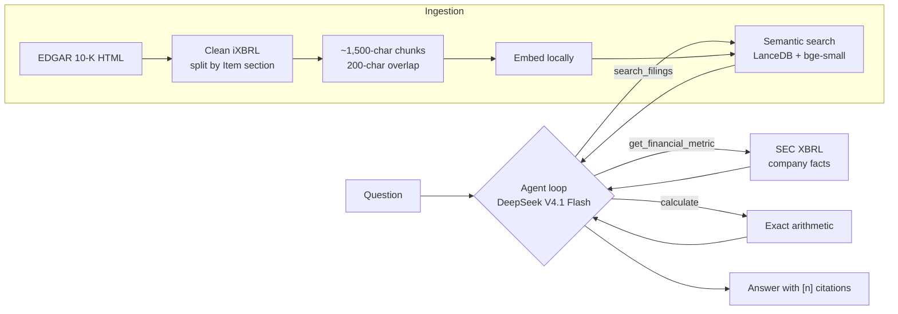

# edgar-rag-analyst

An AI analyst that answers questions about SEC 10-K filings for Apple, Microsoft and NVIDIA, with a citation for every claim. **Explanations come from the filing text (RAG); numbers come from the SEC's structured XBRL data through function calls, and arithmetic is done by a calculator tool.** A 47-question eval suite measures the result.

Everything runs locally except the LLM call: free SEC data, a local embedding model and an embedded vector database.

```
$ edgar ask "Compare Apple, Microsoft and NVIDIA's gross margins in their latest fiscal years,
             and what does NVIDIA say about its customer concentration?"

Tool calls:
  step 1: get_financial_metric(ticker='AAPL', metric='gross_profit', fiscal_year=2025)
          -> [1] Apple Inc. gross_profit FY2025 (2024-09-29 to 2025-09-27): 195,201,000,000.00 USD
  ...     (revenue and gross profit for all three companies, plus one filing search)
  step 2: calculate(operation='ratio', a=153463000000, b=215938000000)
          -> ratio(a=153,463,000,000.00, b=215,938,000,000.00) = 0.7107

| Company   | FY     | Gross Profit | Revenue     | Gross Margin |
|-----------|--------|--------------|-------------|--------------|
| Apple     | FY2025 | $195.2B [1]  | $416.2B [2] | 46.9%        |
| Microsoft | FY2026 | $225.5B [3]  | $331.8B [4] | 67.9%        |
| NVIDIA    | FY2026 | $153.5B [5]  | $215.9B [6] | 71.1%        |

NVIDIA states that "our revenue is concentrated among a limited number of direct and
indirect customers" [7]. In FY2026, one direct customer was 22% of total revenue and
another 14%, both primarily in the Compute & Networking segment [7]. ...

Sources:
 *[1] SEC XBRL GrossProfit, AAPL FY2025 (10-K filed 2025-10-31)
 ...
 *[7] NVIDIA CORP 10-K (2026-01-25), Item 7. Management's Discussion and Analysis ...

3 LLM calls · 8463 prompt + 1205 completion tokens
```

## How it works



1. **Ingest** ([sec_client.py](src/edgar_rag/sec_client.py), [chunking.py](src/edgar_rag/chunking.py), [index.py](src/edgar_rag/index.py)): download each company's latest 10-K, strip the hidden XBRL metadata, split it into Item sections (Risk Factors, MD&A, …), pack paragraphs into ~1,500-character chunks with overlap, embed them locally with `bge-small-en-v1.5`, and store them in LanceDB with company, section and source metadata.
2. **Answer** ([agent.py](src/edgar_rag/agent.py), [tools.py](src/edgar_rag/tools.py)): the LLM gets three tools defined by Pydantic models. It searches filing text for explanations, looks up exact figures in XBRL data, and calls a calculator for growth rates and margins. The loop runs until it answers (6 LLM calls at most), and every source gets a citation number.
3. **Evaluate** ([scoring.py](src/edgar_rag/scoring.py), [evaluation.py](src/edgar_rag/evaluation.py)): a hand-labelled question set scored on numbers, retrieval, key facts (LLM judge) and refusals, comparing the agent with plain RAG.

## Eval results

47 questions across Apple, Microsoft and NVIDIA. Expected numbers come from XBRL; narrative answers are checked against key facts verified in the filing text. **Simple** is plain RAG: one search, then one LLM call, with no tools.

| Metric | agent | simple |
|---|---|---|
| **Overall pass rate** | **100%** | 64% |
| Numeric (12) | 100% | 75% |
| Narrative (16) | 100% | 81% |
| Mixed: numbers + explanation (3) | 100% | 33% |
| Comparison across companies (5) | 100% | 0% |
| Trend across years (4) | 100% | 0% |
| Unanswerable, refused correctly (7) | 100% | 100% |
| Number accuracy | 100% | 41% |
| Retrieval hit rate | 100% | 95% |
| False refusals on answerable questions | 0% | 25% |
| Avg prompt tokens per question | 6,027 | 2,020 |
| Avg seconds per question | 4.2 | 1.8 |

**What this shows:** plain RAG handles single-fact questions but breaks down on anything that needs several figures, exact arithmetic or more than one company: it can't calculate an exact 6.4% growth rate from a table that rounds to "6%". The agent costs about 3× the tokens and 2.3× the time, and answers every question in the set.

Full results per question are in [evals/results/](evals/results/). Run `edgar eval` to reproduce them; results vary by a question or two between runs.

### What the evals caught along the way

Reading every failure turned up as many bugs in the **eval** as in the system:
- The judge model reasons before answering. With a 300-token limit it ran out mid-thought and returned no verdict, which silently scored correct answers as wrong. Missing verdicts and cut-off answers are now reported separately.
- A "Microsoft revenue" question was labelled unanswerable, but the XBRL tool works for any company and the agent answered it correctly.
- Microsoft's filing splits headings across styled `<span>`s ("RIS" + "K FACTORS"). Text extraction now breaks lines only at block elements.
- A search-score cutoff for refusing unanswerable questions was tested and rejected: their top scores (0.64–0.81) overlap with answerable ones (0.67+). The LLM's own refusals are more accurate.

## Setup

Requires Python 3.11+ and an API key for an OpenAI-compatible LLM with function calling (built with DeepSeek).

```bash
git clone https://github.com/giteshpoudel/edgar-rag-analyst.git
cd edgar-rag-analyst
python3 -m venv .venv && source .venv/bin/activate
pip install -e ".[dev]"
cp .env.example .env   # then fill in SEC_USER_AGENT and DEEPSEEK_API_KEY
```

The SEC requires a `User-Agent` with your name and a real contact email; it blocks requests without one.

## Usage

```bash
edgar download AAPL         # latest 10-K, cached in data/raw
edgar chunk AAPL            # clean and split into chunks
edgar index AAPL            # embed and store in LanceDB
edgar ask "How much did Apple's revenue grow in fiscal 2025, and why?"
edgar ask --simple "..."    # plain RAG, no tools (the eval baseline)
edgar search "export controls" --ticker NVDA --item 1A   # retrieval only
edgar eval                  # run the eval suite in both modes
```

## Limitations

- Three companies and their latest 10-K only. The section parser handles Apple, Microsoft and NVIDIA; other filers may format headings differently.
- Twelve financial metrics, annual values only. No quarterly data or segment-level XBRL figures yet.
- Fiscal years are named by the year they end in, which matches these three companies but not every filer.
- The LLM judge uses the same model it grades and sometimes misses correct answers. Spot-checks found one false negative (simple mode, `nar-03`).
- The agent occasionally does small arithmetic in prose (e.g. adding two percentages) instead of calling the calculator; the evals don't check derived numbers inside the explanation yet.

## Project layout

```
src/edgar_rag/
  sec_client.py   EDGAR downloads: User-Agent, throttling, cache
  chunking.py     iXBRL HTML → clean text → Item sections → chunks
  embeddings.py   local bge-small embeddings
  index.py        LanceDB storage
  retriever.py    semantic search with company/section filters
  xbrl.py         exact figures from SEC company facts
  tools.py        tool definitions (Pydantic) and implementations
  agent.py        function-calling loop with shared citation numbering
  answer.py       plain RAG baseline
  prompts.py      system prompts
  scoring.py      number matching, retrieval metrics, LLM judge
  evaluation.py   eval runner and summary
  cli.py          `edgar` command
evals/
  golden.jsonl    47 labelled questions
  results/        per-question results and summary from the last run
```
